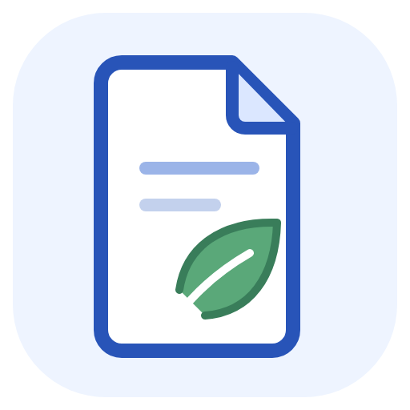

<p align="center">
  
</p>

# AstrBot 网页截图插件

[](LICENSE)
[](https://github.com/Sakura520222/astrbot_plugin_web_analyzer/releases)

> 自动识别聊天中的网页链接，支持命令和助手工具截图。可设置整页、视口、裁剪和加载等待方式。助手也可按需读取网页正文。

截图是插件的默认能力：自动识别消息中的链接，或通过 `/网页截图` 命令与 `capture_webpage` 助手工具截图，按链接与截图参数命中缓存。`get_webpage_content` 助手工具按需返回网页的最终地址、标题和可读正文。网页分析功能已在 v2.0.0 移除，`/网页分析` 保留为截图兼容别名。

## 安装

在 AstrBot WebUI 的插件市场搜索“网页截图插件”，或使用[仓库地址](https://github.com/Sakura520222/astrbot_plugin_web_analyzer)安装（内部 ID 仍为 `astrbot_plugin_web_analyzer`，原位升级保留配置与数据）。最低兼容 AstrBot **4.27.0**。

截图功能需要在 AstrBot 所在的运行环境中安装 Chrome、Edge 或 Chromium。插件通过 CDP 直接使用系统浏览器，不会下载浏览器；Docker 部署时需在容器内安装。截图使用独立临时配置，不会读取日常浏览器的 Cookie 或登录状态。

## 使用

启用自动识别后，直接发送含网页链接的消息即可截图。也可手动运行：

```text
/网页截图 https://example.com
```

| 命令 | 用途 |
| --- | --- |
| `/网页截图 <URL...>` | 截图一个或多个网页；`/网页分析` 为兼容别名 |
| `/网页缓存 [clear]` | 查看或清空截图缓存（管理员） |
| `/网页浏览器 [status\|reload\|cleanup]` | 浏览器诊断（管理员） |

助手工具（由宿主的人格与工具权限管理）：

| 工具 | 用途 |
| --- | --- |
| `capture_webpage(urls)` | 截图并发送原图，向模型返回逐条结果 |
| `get_webpage_content(url)` | 返回最终 URL、标题和有长度上限的可读正文 |

从 v1.x 升级：代理、User-Agent、截图尺寸与等待、访问规则和缓存限制会在首次加载时自动迁移；旧配置为手动、仅分析或关闭截图时，迁移后使用手动截图。旧截图缓存可在管理面板继续查看，历史导出文件留在原目录。已选择旧分析工具的人格需改选新工具。

## 管理面板

在 WebUI 中打开本插件的页面，共四个页签：**截图概览**（自动截图与浏览器状态）、**截图缓存**（预览、搜索、清理）、**访问规则**（生效配置展示与原生配置入口）、**浏览器诊断**（检测结果、实例池、旧版残留清理）。配置在 WebUI 的插件配置页维护，面板为只读展示。

## 文档与许可

- [快速开始](wiki/QuickStart.md)
- [命令说明](wiki/Commands.md)
- [配置指南](wiki/Configuration.md)
- [常见问题](wiki/FAQ.md)
- [技术实现](wiki/TechnicalImplementation.md)
- [开发指南](wiki/Development.md)
- [更新记录](CHANGELOG.md)

本项目使用 [MIT License](LICENSE)。
